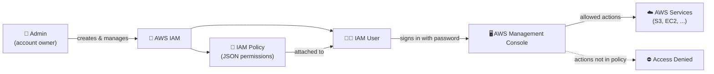
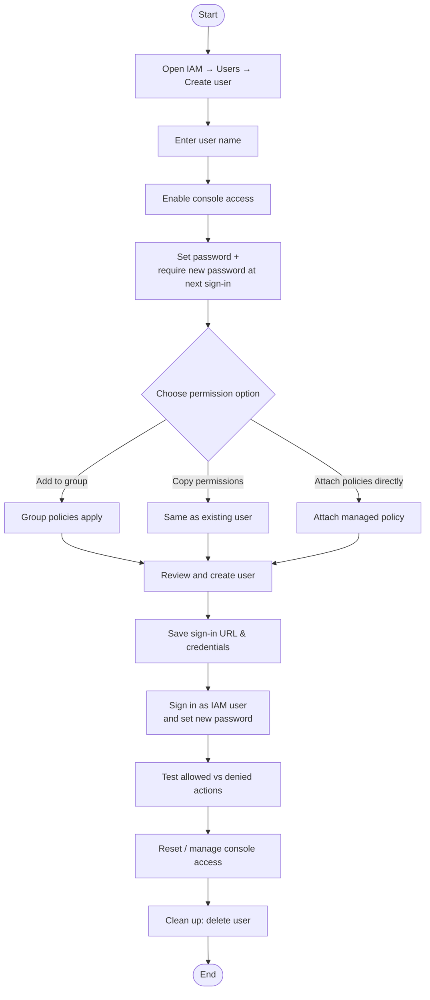
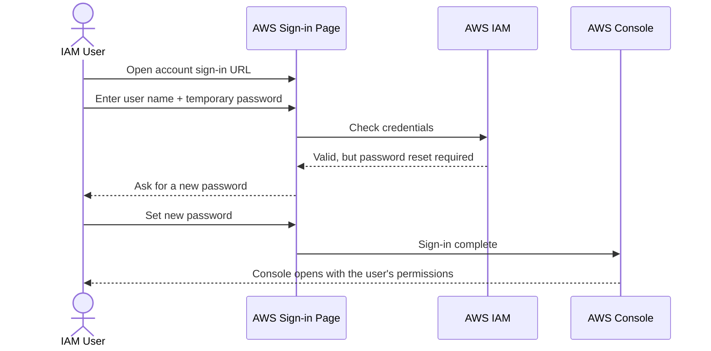
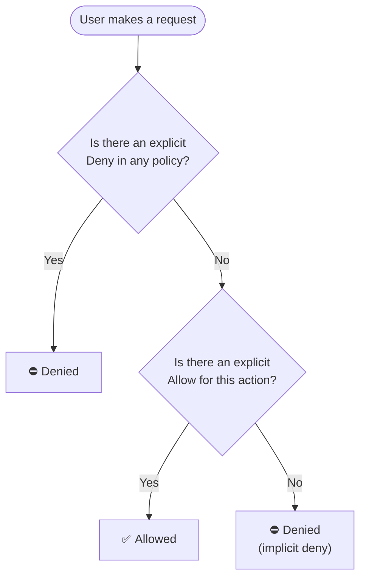

# Lab 05: Creating an IAM User with Console Access and Permissions


## 📑 Contents

1. [Objective](#-objective)
2. [Architecture](#%EF%B8%8F-architecture)
3. [Key Concepts](#-key-concepts)
4. [Lab Workflow](#-lab-workflow)
5. [Steps](#-steps)
6. [How AWS Decides: Allow or Deny](#%EF%B8%8F-how-aws-decides-allow-or-deny)
7. [Common Problems and Fixes](#%EF%B8%8F-common-problems-and-fixes)
8. [Security Best Practices](#-security-best-practices)
9. [Conclusion](#-conclusion)


## 🎯 Objective

In this lab, I created an IAM (Identity and Access Management) user in AWS, gave the user access to the AWS Management Console, required a password reset at first sign-in, and granted permissions by attaching a policy.

The goal is to show how to give a person their own identity in an AWS account instead of sharing the root user, while following the **principle of least privilege**.


## 🏗️ Architecture




## 📘 Key Concepts

| Concept | What it means |
|---------|---------------|
| **Root user** | The email login that created the AWS account. It has full access and should not be used for daily work. |
| **IAM user** | An identity for one person or application, with its own credentials. |
| **Console access** | Lets the user sign in to the AWS Management Console with a password. |
| **IAM group** | A collection of users who share the same permissions. |
| **IAM policy** | A JSON document that allows or denies specific actions on specific resources. |
| **Least privilege** | Give users only the permissions they need to do their job, nothing more. |

### Three ways to give a user permissions

| Option | How it works | Best for |
|--------|--------------|----------|
| **Add user to group** | The user gets all permissions attached to the group | Teams; the recommended way |
| **Copy permissions** | Copies groups and policies from an existing user | Onboarding someone with the same job as a colleague |
| **Attach policies directly** | The policy is attached to this one user only | Quick tests and one-off cases (used in this lab) |


## 🔄 Lab Workflow




## 🧪 Steps

### 1. Open the IAM Console

I signed in to the AWS Management Console, searched for **IAM**, and opened **Users** from the left menu. I then selected **Create user**.

<!-- 📸 Screenshot: IAM dashboard / Users page -->


### 2. Set User Details and Enable Console Access

I entered a user name and ticked **Provide user access to the AWS Management Console**, then selected **I want to create an IAM user**.

For the console password, I chose a password and enabled **Users must create a new password at next sign-in**, so the user sets their own password the first time they log in.

<!-- 📸 Screenshot: User details page with console access options -->


### 3. Set Permissions

On the **Set permissions** page, I selected **Attach policies directly** and attached the **[policy name]** policy.

<!-- 📸 Screenshot: Set permissions page with the selected policy -->

> **Note:** For this lab, a policy was attached directly to the user. In a real environment, it is better to attach policies to **groups** and add users to those groups, so permissions are easier to manage.

**What a policy looks like.** Below is a simple example policy that allows read-only access to S3. Every policy statement is built from the same parts: `Effect`, `Action` and `Resource`.

```json
{
  "Version": "2012-10-17",
  "Statement": [
    {
      "Effect": "Allow",
      "Action": [
        "s3:Get*",
        "s3:List*"
      ],
      "Resource": "*"
    }
  ]
}
```

| Part | Meaning in this example |
|------|-------------------------|
| `Effect` | `Allow` (or `Deny`) |
| `Action` | Which API actions: here, any S3 action starting with `Get` or `List` |
| `Resource` | Which resources: `*` means all of them |


### 4. Review and Create the User

I reviewed the user details and permissions summary, then selected **Create user**.

On the **Retrieve password** page, AWS showed the **console sign-in URL**, the user name and the password. This information can also be downloaded as a `.csv` file.

<!-- 📸 Screenshot: Review page / user created successfully (hide the password and account ID) -->


### 5. Sign In as the New IAM User

I opened the console sign-in URL in a private browser window, signed in with the IAM user name and password, and was asked to set a new password.



<!-- 📸 Screenshot: IAM user sign-in page -->
<!-- 📸 Screenshot: Change password page -->


### 6. Test the Permissions

I tested what the user could and could not do. Actions included in the policy worked, while actions outside the policy showed an **access denied** message.

| Test | Expected result |
|------|-----------------|
| Action allowed by the attached policy | ✅ Works |
| Action not in the policy | ⛔ Access denied |
| Open IAM to create another user | ⛔ Access denied (no IAM permissions) |

<!-- 📸 Screenshot: Allowed action -->
<!-- 📸 Screenshot: Access denied message -->


### 7. Reset / Manage Console Access

Back as the admin, I opened the user, went to the **Security credentials** tab, and selected **Manage console access**.

From here, an administrator can:

- **Reset the password** (auto-generated or custom)
- Require a new password at next sign-in
- **Disable** console access completely

<!-- 📸 Screenshot: Security credentials tab → Manage console access -->


### 8. Verify and Change Permissions

I opened the **Permissions** tab of the user to confirm the policy was attached. Permissions can be added with **Add permissions** or removed with **Remove**.

<!-- 📸 Screenshot: Permissions tab showing the attached policy -->


### 9. Clean Up

After the lab, I deleted the IAM user to keep the account secure.

<!-- 📸 Screenshot: User deleted -->


## ⚖️ How AWS Decides: Allow or Deny

Every time the user does something, AWS checks their policies. By default, **everything is denied** until a policy allows it, and an explicit **Deny always wins**.



This is why the new user could only do what the attached policy allowed: everything else fell through to the **implicit deny**.


## 🛠️ Common Problems and Fixes

| Problem | Cause | Fix |
|---------|-------|-----|
| User can't sign in | Using the root sign-in page instead of the IAM sign-in URL | Use the account-specific sign-in URL, or choose **IAM user** and enter the account ID |
| "Access denied" on an action | The policy does not allow that action | Attach a policy that includes the action, following least privilege |
| Forgot the temporary password | The `.csv` file was not saved | Admin resets it via **Security credentials → Manage console access** |
| Password not accepted | Doesn't meet the account's password policy | Use a longer password with mixed characters |


## 🔒 Security Best Practices

- [x] Use IAM users (or IAM Identity Center) instead of the root user for daily work
- [x] Require a new password at first sign-in
- [x] Give only the permissions needed (least privilege)
- [ ] Enable **MFA** for every user with console access
- [ ] Manage permissions with **groups** instead of attaching policies directly
- [ ] Never share or commit passwords, `.csv` credential files or access keys
- [ ] Remove users and permissions that are no longer needed


## ✅ Conclusion

This lab demonstrated how to create an IAM user, enable and reset console access, and control what the user can do with policies. I also learned how AWS evaluates permissions: everything is denied by default, an Allow grants access, and an explicit Deny always wins. Using individual IAM users with least-privilege permissions is much safer than sharing the root account.
