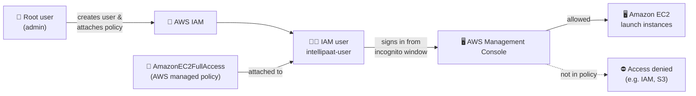
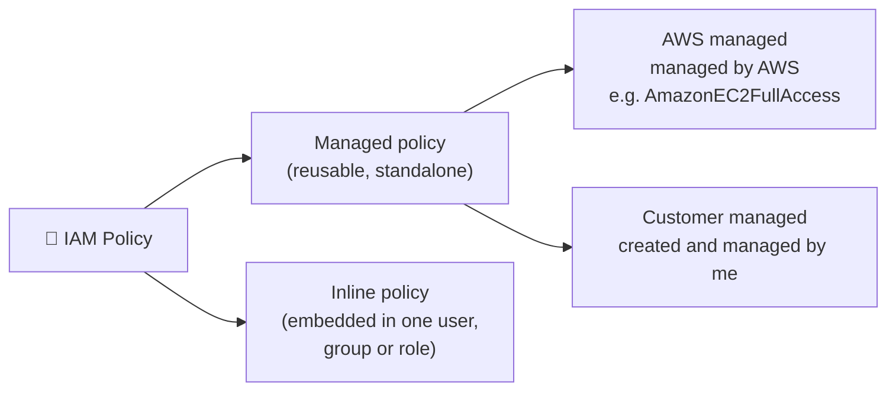
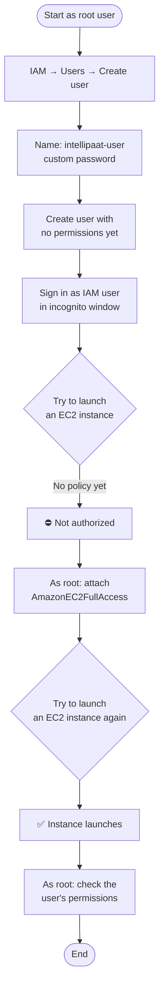
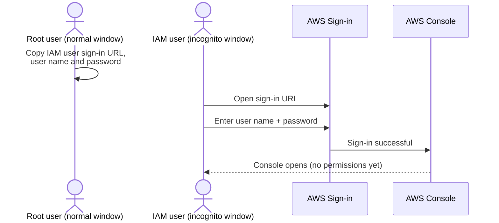

# Lab 05: IAM Demo 1 – Create an IAM User and Test Console Access


> **IAM series:** **Demo 1 – Console access** (this lab) · [Demo 2 – AWS CLI access](../06-iam-user-aws-cli-access)

## 📑 Contents

1. [Objective](#-objective)
2. [Architecture](#%EF%B8%8F-architecture)
3. [Key Concepts](#-key-concepts)
4. [Lab Workflow](#-lab-workflow)
5. [Steps](#-steps)
6. [How AWS Decides: Allow or Deny](#%EF%B8%8F-how-aws-decides-allow-or-deny)
7. [Common Problems and Fixes](#%EF%B8%8F-common-problems-and-fixes)
8. [Security Best Practices](#-security-best-practices)
9. [Conclusion](#-conclusion)


## 🎯 Objective

In this lab, I created my first IAM (Identity and Access Management) user, signed in to the AWS Management Console as that user, and tested what the user could do **before and after** attaching a permission policy.

The goal is to show that a new IAM user has **no permissions by default**, and that access is granted only through policies, following the **principle of least privilege**.


## 🏗️ Architecture




## 📘 Key Concepts

| Concept | What it means |
|---------|---------------|
| **Root user** | The email login that created the AWS account. It has full access and should not be used for daily work. |
| **IAM user** | An identity for one person or application, with its own credentials. |
| **Console access** | Lets the user sign in to the AWS Management Console with a user name and password. |
| **IAM policy** | A set of permissions. It is a JSON document that defines which actions are allowed or denied on which AWS resources. Think of it as a permission sheet attached to a user, group or role. |
| **Least privilege** | Permissions are limited to what a person needs for their job responsibilities. |

### Types of IAM policies



In the IAM console under **Policies**, the **Type** column shows whether a policy is AWS managed or customer managed.

### Ways to give a user permissions

| Option | How it works | Best for |
|--------|--------------|----------|
| **Add user to group** | The user gets all permissions attached to the group | Teams; the recommended way |
| **Copy permissions** | Copies groups and policies from an existing user | Someone with the same job as a colleague |
| **Attach policies directly** | The policy is attached to this one user only | Quick tests (used in this lab) |


## 🔄 Lab Workflow




## 🧪 Steps

### 1. Create the IAM User

Signed in as the root user, I went to **IAM → Users → Create user**.

- **User name:** `intellipaat-user`
- Ticked **Provide user access to the AWS Management Console**
- Selected **Custom password** and entered a password
- **Unticked** *Users must create a new password at next sign-in*, so I could sign in straight away with the same password for this demo

<!-- 📸 Screenshot: Specify user details page -->


### 2. Set Permissions and Create the User

On the **Set permissions** page, I kept **Add user to group** selected but did not choose a group, so the user was created **without any permissions**. I clicked **Next**, then **Create user**.

<!-- 📸 Screenshot: Set permissions page -->
<!-- 📸 Screenshot: User created successfully (hide the password and account ID) -->


### 3. Sign In as the IAM User

I opened an **incognito (private) browser window**, pasted the **IAM user sign-in URL**, and signed in with the user name and password.

Using incognito let me stay signed in as the root user in my normal window and as the IAM user in the private window at the same time.



<!-- 📸 Screenshot: IAM user sign-in page -->
<!-- 📸 Screenshot: Console signed in as intellipaat-user -->


### 4. Test Before Attaching a Policy

As the IAM user, I tried to use EC2. Because no policy was attached, the console showed **not authorized / access denied** messages.

<!-- 📸 Screenshot: Access denied before the policy -->


### 5. Attach the AmazonEC2FullAccess Policy

Back in the root user window, I went to **IAM → Users → intellipaat-user → Permissions → Add permissions → Attach policies directly**, searched for **AmazonEC2FullAccess**, ticked the checkbox, clicked **Next**, then **Add permissions**.

<!-- 📸 Screenshot: Searching for AmazonEC2FullAccess -->
<!-- 📸 Screenshot: Policy attached to the user -->


### 6. Test After Attaching the Policy

In the IAM user's incognito window, I clicked **Launch instance** to check whether the user could now launch an EC2 instance.

| Test as `intellipaat-user` | Before policy | After AmazonEC2FullAccess |
|----------------------------|:-------------:|:-------------------------:|
| Launch an EC2 instance | ⛔ Denied | ✅ Allowed |
| View EC2 instances | ⛔ Denied | ✅ Allowed |
| Create IAM users | ⛔ Denied | ⛔ Denied (not in policy) |

<!-- 📸 Screenshot: Instance launched as the IAM user -->


### 7. Check the User's Permissions as Root

Finally, in the root user window, I opened the user's **Permissions** tab and clicked on the attached policy to see exactly which permissions the user has. Clicking **{} JSON** shows the policy document.

<!-- 📸 Screenshot: Permissions tab / policy JSON -->


## ⚖️ How AWS Decides: Allow or Deny

Every time the user does something, AWS checks their policies. By default, **everything is denied** until a policy allows it, and an explicit **Deny always wins**.


This explains both test results: **before** the policy, nothing was allowed, so EC2 fell through to the implicit deny. **After** attaching AmazonEC2FullAccess, EC2 actions had an explicit Allow, but IAM actions still did not.

**What a policy looks like.** A simplified version of the EC2 full-access idea:

```json
{
  "Version": "2012-10-17",
  "Statement": [
    {
      "Effect": "Allow",
      "Action": "ec2:*",
      "Resource": "*"
    }
  ]
}
```

| Part | Meaning |
|------|---------|
| `Effect` | `Allow` or `Deny` |
| `Action` | Which API actions; `ec2:*` means every EC2 action |
| `Resource` | Which resources; `*` means all of them |


## 🛠️ Common Problems and Fixes

| Problem | Cause | Fix |
|---------|-------|-----|
| IAM user can't sign in | Using the root sign-in page instead of the IAM user sign-in URL | Use the account-specific sign-in URL, or choose **IAM user** and enter the account ID |
| Signing in as the IAM user logs out the root user | Both sessions in the same browser window | Use an incognito/private window for the IAM user |
| "Not authorized" when launching an instance | No policy attached yet | Attach a policy that allows the action (here AmazonEC2FullAccess) |
| Changes don't show in the IAM user's window | Page not refreshed after attaching the policy | Refresh the console page |


## 🔒 Security Best Practices

- [x] Use an IAM user instead of the root user for daily work
- [x] Start with no permissions and add only what is needed
- [ ] Use a narrower policy than full access in real environments (e.g. read-only)
- [ ] Require a new password at first sign-in for real users
- [ ] Enable **MFA** for every user with console access
- [ ] Manage permissions with **groups** instead of attaching policies directly
- [ ] Terminate test instances and delete unused users after the lab


## ✅ Conclusion

This lab showed that a new IAM user can sign in but can do nothing until a policy grants permissions. After attaching **AmazonEC2FullAccess**, the user could launch EC2 instances but still could not manage IAM, which demonstrates least privilege and how AWS evaluates permissions.

➡️ **Next:** [IAM Demo 2 – Check an IAM user's access with the AWS CLI](../06-iam-user-aws-cli-access)
