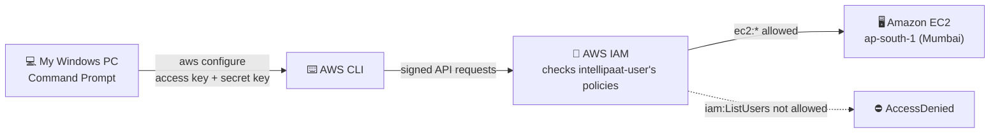
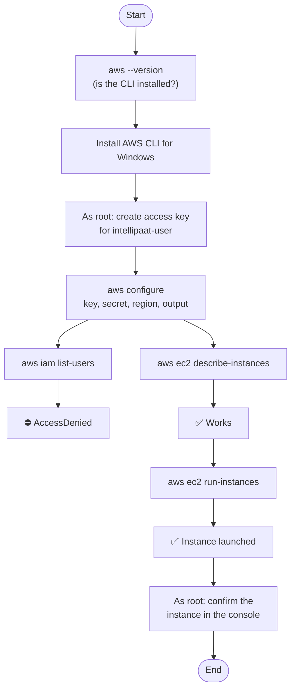
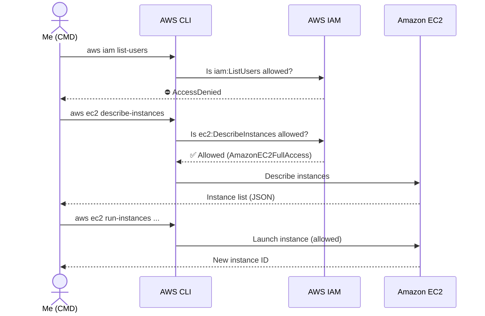

# Lab 06: IAM Demo 2 – Check an IAM User's Access with the AWS CLI


> **IAM series:** [Demo 1 – Console access](../05-iam-user-console-access) · **Demo 2 – AWS CLI access** (this lab)

## 📑 Contents

1. [Objective](#-objective)
2. [Architecture](#%EF%B8%8F-architecture)
3. [Console Access vs Programmatic Access](#-console-access-vs-programmatic-access)
4. [Lab Workflow](#-lab-workflow)
5. [Steps](#-steps)
6. [Results](#-results)
7. [Common Problems and Fixes](#%EF%B8%8F-common-problems-and-fixes)
8. [Security Best Practices](#-security-best-practices)
9. [Conclusion](#-conclusion)


## 🎯 Objective

In this lab, I used the **AWS Command Line Interface (CLI)** on Windows to check what the IAM user from [Demo 1](../05-iam-user-console-access) (`intellipaat-user`, with **AmazonEC2FullAccess**) can do.

I created an **access key** for the user, configured the CLI, tested an IAM action and EC2 actions, and launched an EC2 instance from the command line.


## 🏗️ Architecture




## 🔑 Console Access vs Programmatic Access

| | Console access (Demo 1) | Programmatic access (Demo 2) |
|---|---|---|
| **Used with** | AWS Management Console in a browser | AWS CLI, SDKs, scripts |
| **Credentials** | User name + password | Access key ID + secret access key |
| **Where created** | When creating the user, or **Manage console access** | User → **Security credentials → Access keys** |
| **Permissions** | Same IAM policies | Same IAM policies |

The permissions are the same either way: the policy decides what the user can do, no matter how they connect.


## 🔄 Lab Workflow




## 🧪 Steps

### 1. Check Whether the AWS CLI Is Installed

I opened **Command Prompt** and ran:

```cmd
aws --version
```

The CLI was not installed yet, so I searched for **Install AWS CLI** on Google, downloaded the Windows installer from the official AWS documentation, installed it, and ran the command again to confirm.

<!-- 📸 Screenshot: aws --version output -->


### 2. Create an Access Key for the IAM User

As the root user, I went to **IAM → Users → intellipaat-user → Security credentials → Access keys → Create access key**.

- Use case: **Local code**
- Ticked **I understand the above recommendation and want to proceed to create an access key**
- Clicked **Next → Create access key**

AWS then showed the **Access key ID** and **Secret access key**. The secret key is shown **only once**, so it must be saved securely (or downloaded as `.csv`).

<!-- 📸 Screenshot: Create access key – use case (hide the keys!) -->

> ⚠️ **Never** put access keys in screenshots, code or GitHub. Anyone with them can act as this user.


### 3. Configure the AWS CLI

Back in Command Prompt:

```cmd
aws configure
```

```text
AWS Access Key ID [None]: <your-access-key-id>
AWS Secret Access Key [None]: <your-secret-access-key>
Default region name [None]: ap-south-1
Default output format [None]: json
```

<!-- 📸 Screenshot: aws configure (keys hidden) -->


### 4. Test an IAM Action

The user only has **AmazonEC2FullAccess**, so IAM actions should be denied:

```cmd
aws iam list-users
```

Result: an **AccessDenied** error, similar to:

```text
An error occurred (AccessDenied) when calling the ListUsers operation:
User: arn:aws:iam::<account-id>:user/intellipaat-user is not authorized
to perform: iam:ListUsers ...
```

<!-- 📸 Screenshot: aws iam list-users AccessDenied -->


### 5. Test an EC2 Action

EC2 actions should work:

```cmd
aws ec2 describe-instances
```

Result: the command returned the EC2 instances in `ap-south-1` as JSON.

<!-- 📸 Screenshot: aws ec2 describe-instances output -->


### 6. Launch an EC2 Instance with the CLI

I checked the **AWS CLI Command Reference** online (Amazon Q can also help build commands) for `run-instances`.

On **Windows Command Prompt**, a long command is split over several lines with `^`, not the `\` used on Linux/macOS:

```cmd
aws ec2 run-instances ^
    --image-id <ami-id> ^
    --instance-type t2.micro ^
    --key-name <key-pair-name> ^
    --count 1
```

| Shell | Line continuation character |
|-------|:---------------------------:|
| Windows Command Prompt | `^` |
| Windows PowerShell | `` ` `` (backtick) |
| Linux / macOS | `\` |

<!-- 📸 Screenshot: run-instances command and output -->


### 7. Confirm as the Root User

I signed in as the root user, opened **EC2 → Instances** in the **Mumbai (ap-south-1)** region, and confirmed the instance launched from the CLI was running.

<!-- 📸 Screenshot: Instance visible in the EC2 console -->


## 📊 Results



| Command | Permission needed | Result |
|---------|-------------------|:------:|
| `aws iam list-users` | `iam:ListUsers` | ⛔ AccessDenied |
| `aws ec2 describe-instances` | `ec2:DescribeInstances` | ✅ Success |
| `aws ec2 run-instances` | `ec2:RunInstances` | ✅ Instance launched |


## 🛠️ Common Problems and Fixes

| Problem | Cause | Fix |
|---------|-------|-----|
| `'aws' is not recognized as an internal or external command` | AWS CLI not installed, or CMD opened before install | Install the CLI, then open a **new** Command Prompt |
| `aws ec2 list-users` fails | There is no such EC2 command; users belong to IAM | Use `aws iam list-users` for users, `aws ec2 describe-instances` for instances |
| Multi-line command fails on Windows | Used `\` for line breaks | Use `^` in CMD (or put the command on one line) |
| No instances shown / instance "missing" | Console or CLI pointing to a different region | Check the region (`ap-south-1`) in both |
| `InvalidClientTokenId` / `SignatureDoesNotMatch` | Access key or secret typed wrongly | Run `aws configure` again with the correct keys |


## 🔒 Security Best Practices

- [x] Create access keys for an IAM user, **never** for the root user
- [x] Test that the user can only do what the policy allows
- [ ] Never share, screenshot or commit access keys
- [ ] **Deactivate and delete** the access key after the lab
- [ ] Rotate access keys regularly in real environments
- [ ] Prefer short-term credentials (IAM roles, IAM Identity Center) over long-term access keys
- [ ] Terminate the test EC2 instance to avoid charges


## ✅ Conclusion

This lab showed that an IAM user's permissions are the same in the CLI as in the console. With **AmazonEC2FullAccess**, `intellipaat-user` could list and launch EC2 instances from the command line, but `aws iam list-users` was denied. I also learned how to create access keys, configure the CLI, and write multi-line commands on Windows using `^`.

⬅️ **Previous:** [IAM Demo 1 – Create an IAM user and test console access](../05-iam-user-console-access)
