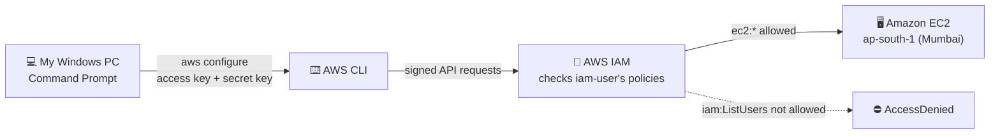
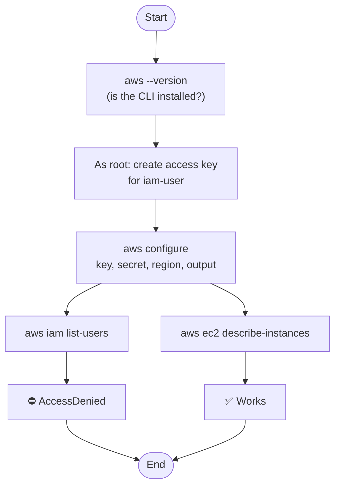

# Lab 06: IAM Demo 2 – Check an IAM User's Access with the AWS CLI


> **IAM series:** [Demo 1 – Console access](../05-iam-user-console-access) · **Demo 2 – AWS CLI access** (this lab)

##  Contents

1. [Objective](#objective)
2. [Architecture](#architecture)
3. [Console Access vs Programmatic Access](#console-access-vs-programmatic-access)
4. [Lab Workflow](#lab-workflow)
5. [Steps](#steps)
6. [Results](#results)
7. [Problems I Ran Into](#problems-i-ran-into)
8. [Security Best Practices](#security-best-practices)
9. [Conclusion](#conclusion)


##  Objective

In this lab, I used the **AWS Command Line Interface (CLI)** on Windows to check what the IAM user from [Demo 1](../05-iam-user-console-access) (`iam-user`, with **AmazonEC2FullAccess**) can do.

I created an **access key** for the user, configured the CLI, and tested an IAM action and an EC2 action to see which were allowed.


##  Architecture

##  Console Access vs Programmatic Access

| | Console access (Demo 1) | Programmatic access (Demo 2) |
|---|---|---|
| **Used with** | AWS Management Console in a browser | AWS CLI, SDKs, scripts |
| **Credentials** | User name + password | Access key ID + secret access key |
| **Where created** | When creating the user, or **Manage console access** | User → **Security credentials → Access keys** |
| **Permissions** | Same IAM policies | Same IAM policies |

The permissions are the same either way: the policy decides what the user can do, no matter how they connect.


##  Lab Workflow




##  Steps

### 1. Check Whether the AWS CLI Is Installed

I opened **Command Prompt** and ran:

```cmd
aws --version
```

The CLI was already installed.


### 2. Create an Access Key for the IAM User

As the root user, I went to **IAM → Users → iam-user → Security credentials → Access keys → Create access key**.

- Use case: **Local code**
- Ticked **I understand the above recommendation and want to proceed to create an access key**
- Clicked **Next → Create access key**

AWS then showed the **Access key ID** and **Secret access key**. The secret key is shown **only once**, so it must be saved securely (or downloaded as `.csv`).


### 3. Configure the AWS CLI

Back in Command Prompt:

```cmd
aws configure
```

```text
AWS Access Key ID [None]: <your-access-key-id>
AWS Secret Access Key [None]: <your-secret-access-key>
Default region name [None]: ap-south-1
Default output format [None]: json
```


### 4. Test an IAM Action

The user only has **AmazonEC2FullAccess**, so IAM actions should be denied:

```cmd
aws iam list-users
```

Result: an **AccessDenied** error, similar to:

```text
An error occurred (AccessDenied) when calling the ListUsers operation:
User: arn:aws:iam::xxxxxxxxxxxx:user/iam-user is not authorized
to perform: iam:ListUsers ...
```


### 5. Test an EC2 Action

EC2 actions should work:

```cmd
aws ec2 describe-instances
```
Result: the command returned the EC2 instances in `ap-south-1` as JSON.


##  Results

| Command | Permission needed | Result |
|---------|-------------------|:------:|
| `aws iam list-users` | `iam:ListUsers` | ⛔ AccessDenied |
| `aws ec2 describe-instances` | `ec2:DescribeInstances` | ✅ Success |

The user is **authenticated** in both cases (AWS knows who it is), but only the EC2 action is **authorized** by the attached policy.


##  Problems I Ran Into

| Problem | Cause | Fix |
|---------|-------|-----|
| `aws iam list-users` → **AccessDenied** | Not a bug: the user only has AmazonEC2FullAccess, so no policy allows `iam:ListUsers` (implicit deny) | Expected result. Attaching **IAMReadOnlyAccess** would allow listing users |
| `aws ec2 list-users` → **Invalid choice 'list-users'** | There is no such EC2 command; users belong to IAM | Use `aws iam list-users` for users and `aws ec2 describe-instances` for instances. `aws ec2 help` lists valid commands |
| `run-instances` with `<ami-id>` → **The system cannot find the file specified** | In Windows CMD, `<` and `>` mean file redirection, so CMD looked for a file called `ami-id` | Replace placeholders with real values and remove the `< >` |
| `run-instances` → **InvalidAMIID.NotFound** | Used an example AMI ID that does not exist | Look up a real AMI ID for the region, e.g. `aws ec2 describe-images --owners amazon ...` or from the EC2 launch page |
| Multi-line command fails on Windows | Used `\` for line breaks (Linux style) | Use `^` in CMD (or `` ` `` in PowerShell) |


##  Security Best Practices

- [x] Create access keys for an IAM user, **never** for the root user
- [x] Test that the user can only do what the policy allows
- [ ] Never share, screenshot or commit access keys
- [ ] **Deactivate and delete** the access key after the lab
- [ ] Rotate access keys regularly in real environments
- [ ] Prefer short-term credentials (IAM roles, IAM Identity Center) over long-term access keys


##  Conclusion

This lab showed that an IAM user's permissions are the same in the CLI as in the console. With **AmazonEC2FullAccess**, the user could describe EC2 instances from the command line, but `aws iam list-users` was denied. I also learned how to create access keys, configure the CLI, and read CLI errors: **AccessDenied** means the command exists but the user isn't allowed, while **Invalid choice** means the command doesn't exist.

⬅️ **Previous:** [IAM Demo 1 – Create an IAM user and test console access](../05-iam-user-console-access)
